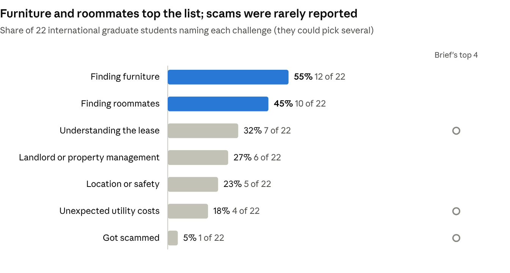

# Housing Survey Findings for the Midpoint Memo

Oct 15, 2026 · John Kwon

## Summary

Finding furniture and finding roommates are the top two challenges for the 22 international graduate students we surveyed, not scams. That changes the priorities set in our background brief.

1. **Furniture is the most common pain point: 12 of 22 (55%).** Our brief treated furniture as a later module. The survey says it belongs in the core product, which supports the furniture board prototype now on the website.
2. **Roommates come second: 10 of 22 (45%).** Nine students named both furniture and roommates. Both are about setting up a shared home after the lease, which our current tools only partly cover.
3. **Leases still matter, and scams were rarely reported.** Seven (32%) flagged understanding their lease, which backs LeaseCheck. Only one reported being scammed, but 14 of 22 live in university housing, which shields them from the private market.

## Who answered

All 22 respondents are international graduate students, and most live in university housing. Responses came in between Sept 19 and Sept 25, 2026, through our anonymous Google Form "Housing Survey".

| Group | Respondents | Share | Average challenges picked |
| --- | --- | --- | --- |
| Live in university housing | 14 | 64% | 1.9 |
| Live off campus | 8 | 36% | 2.9 |
| Total | 22 | 100% | 2.4 |

Off-campus students picked about one more challenge each than students in university housing. Seven people left an email for follow-up, a ready pool for interviews or prototype testing (emails are kept out of this doc).

## Biggest challenges

*Source: Housing Survey (Google Form) export, 22 responses, Sept 19–25, 2026. Circles mark the four pain points named in the background brief.*

Three of the four pain points in our background brief (leases, utilities, scams) rank third or lower; the fourth, banking, wasn't a form option. Off-campus students reported more of every problem: 6 of 8 named furniture and 3 of 8 named utility costs, against 6 of 14 and 1 of 14 in university housing.

## In their own words

Cost is the biggest theme students raised unprompted: 6 of 22 mentioned rent, price or value, even though the form had no option for it. Below are the themes from the "Other" box and the open question, grouped by us.

| Theme | Respondents | What they said |
| --- | --- | --- |
| Cost and value | 6 | "High rent costs"; "Price and understand if something was 'worth it' for the market" |
| Searching from abroad | 2 | "I could not inspect the place in person"; arranging visits and calls |
| Landlord and move-in process | 2 | "No proper communication with the landlord and move in procedures"; expectations of housing conditions |
| Amenities | 1 | Hard to find units with A/C and laundry |
| Timing | 1 | "Tight timeline between having to be on campus and actually being able to move into the apartment" |
| Banking from abroad | 1 | "Setting up a bank account from abroad was a real hassle" |
| Trusting housemates | 1 | "Not sure how to verify if my housemates are nice people" |
| Family and schools | 1 | Didn't know what help Cambridge offers for preschool and school |
| Transit | 1 | Public transportation reliability |
| Avoided the private market | 1 | "I opted for university housing to avoid scamming and potentially bad landlords" |
| No issues | 2 | "Nothing"; "None of the above" |

## Background brief vs. survey

The survey confirms our focus on leases but moves furniture and roommates from "later modules" to the top of the list. Scams and banking were central in the brief and look smaller here, partly because of who answered.

| What the background brief assumed | What the survey shows | Verdict |
| --- | --- | --- |
| Furniture exchange is a later module | Top challenge: 12 of 22 (55%) | Changed: move into the core product |
| Roommates are one task among many | Second challenge: 10 of 22 (45%) | Changed: make it a priority |
| Understanding leases is a top pain point | 7 of 22 (32%) | Held |
| Scams are a top pain point | 1 of 22 (5%) reported being scammed | Weaker than expected, likely because 64% live in university housing |
| Utility costs are a top pain point | 4 of 22 (18%); 3 of the 4 live off campus | Partly held: an off-campus issue |
| Opening a bank account is a top pain point | Not a form option; 1 open-text mention | Not tested yet |
| Affordability is a secondary issue | 6 of 22 raised cost unprompted | Bigger than expected |
| The first version will not be a marketplace | Our furniture board lets students list and reserve items | Open question: decide whether a peer exchange fits our scope |

## How our repo work maps to the findings

Our work since the background brief already lines up with the top three findings: each has a process map and a prototype. The weakest coverage is what happens after move-in: landlord problems, utilities and cost.

| Survey finding | What we built (repo location, author) | Coverage |
| --- | --- | --- |
| Finding furniture, 55% | Furniture process map ([`03-Midpoint-Memo/process-map.html`](process-map.html), John); furniture board prototype ([Furniture page](../website/furniture.html), John) | Strong |
| Finding roommates, 45% | Housemate search process map and Housemate Navigator prototype ([`housemate-process-map.html`](housemate-process-map.html), [`housemate-navigator-prototype-Elsa.html`](../99-Indiv%20work/housemate-navigator-prototype-Elsa.html), Elsa; embedded on the [Roommates page](../website/roommates.html#navigator)); roommate board ([Roommates page](../website/roommates.html)) | Strong |
| Understanding the lease, 32% | LeaseCheck Boston prototype (`99-Indiv work`, Andrea; embedded on the website); lease glossary ([Your lease page](../website/lease.html)); Mustafa's lease experience case | Strong |
| Landlord and property management, 27% | Agent verification checklist ([Avoid scams page](../website/scams.html)); Mustafa's case shows repair, deposit and billing disputes after move-in | Partial: nothing for problems after move-in |
| Location and safety, 23% | Rent and distance comparison ([Where to live page](../website/where-to-live.html)) | Partial: no safety information |
| Utility costs, 18% | Utilities card in the lease glossary; Mustafa's case ($600 gas bill, $500 water charge with no bill shown) | Gap |
| Cost and value, 6 unprompted | Rent comparison, Cambridge vs. Allston ([Where to live page](../website/where-to-live.html)) | Partial |
| Banking from abroad, 1 mention | Lease and bank process map (`99-Indiv work`, Andrea); banking section (removed from the website in October) | Strong for a small need |
| Scams, 5% | Scam section and agent checklist ([Avoid scams page](../website/scams.html)); relationship map flags landlord scam risk (Andrea) | Strong for a small need |

The stakeholder and relationship maps from the background brief still hold: students sit at the center of the network, and no group holds landlords accountable. That gap matches the after-move-in problems students described.

## Gaps and next steps

For the second half, we should test what we've built with real students and close the after-move-in gap before the Class 8 adoption policy.

- [ ] Decide whether the furniture board stays a peer exchange or becomes a referral page, since the brief ruled out a marketplace
- [ ] Consider one "setting up your home" module covering furniture and roommates, since 9 of the 13 students who named either named both
- [ ] Test LeaseCheck, the furniture board and the Housemate Navigator with the 7 respondents who offered to talk
- [ ] Add help for after move-in: repairs, deposit returns, disputed utility bills and free city inspections (from Mustafa's case)
- [ ] Add a utility cost estimate by building type and neighborhood
- [ ] Run a second survey round that reaches more off-campus and non-HKS students, adds cost, banking and timing as options, and asks how serious each problem was
- [ ] Use these rankings to choose the first module the partner adopts in the adoption policy

## Limitations

With 22 self-selected respondents, these results show direction, not prevalence.

- **Small, convenience sample.** Shared through our own networks, mostly HKS; 64% live in university housing, so private-market problems such as scams and utilities are likely undercounted.
- **No comparison group.** Everyone is international, so we can't say which problems are specific to international students.
- **Presence, not severity.** The form asked which challenges students faced, not how serious they were. One scam can cost more than several furniture hassles.
- **An unclear option.** "Did you understand the lease you signed?" was a checkbox among challenges, so we read a tick as "understanding the lease was hard".
- **No options for cost, banking or timing.** These came up only in free text, so they are probably undercounted too.
